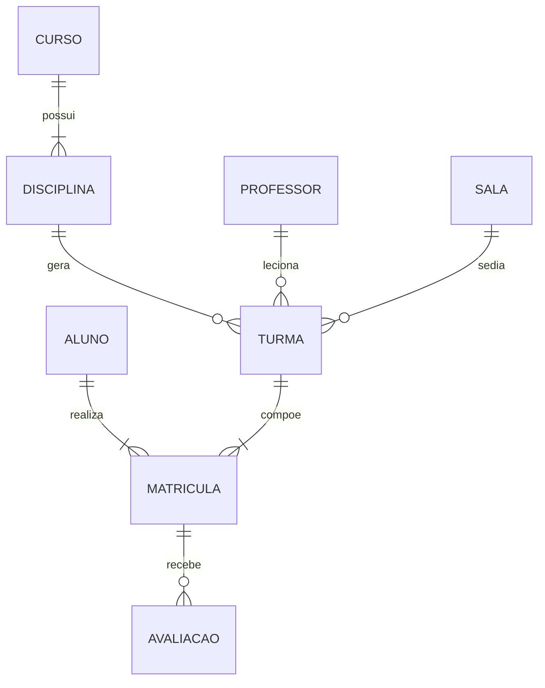

# Especificação Conceitual do Banco de Dados (MER)

## 1. Entidades

* **Aluno**
  * **Definição:** Representa a pessoa matriculada na instituição que cursa as disciplinas e possui registro de notas e frequência.
* **Professor**
  * **Definição:** Representa o docente encarregado de ministrar as disciplinas e lançar as avaliações.
* **Curso**
  * **Definição:** Representa o programa acadêmico (ex: Informática, Administração) que agrupa um conjunto de disciplinas.
* **Disciplina**
  * **Definição:** Representa a matéria ou unidade curricular oferecida em determinado curso.
* **Sala**
  * **Definição:** Representa o espaço físico da instituição (sala de aula, laboratório ou auditório) onde as turmas acontecem.
* **Turma**
  * **Definição:** Representa a oferta prática de uma disciplina em um período específico com professor, sala e horários vinculados.
* **Matrícula**
  * **Definição:** Representa a associação e o histórico do aluno em uma turma específica, registrando nota final e faltas.
* **Avaliação**
  * **Definição:** Representa cada prova, trabalho ou seminário realizado pelo aluno em uma matrícula, cuja média compõe a nota final.

## 2. Relacionamentos e Cardinalidades

* **[Curso] (1,1) — *possui* — (1,N) [Disciplina]**
  * **Explicação:** Um Curso possui 1 ou várias Disciplinas, mas cada Disciplina pertence a apenas 1 Curso específico.
* **[Disciplina] (1,1) — *gera* — (0,N) [Turma]**
  * **Explicação:** Uma Disciplina pode dar origem a nenhuma ou várias Turmas, mas cada Turma pertence a apenas 1 Disciplina.
* **[Professor] (1,1) — *leciona* — (0,N) [Turma]**
  * **Explicação:** Um Professor pode ministrar nenhuma ou várias Turmas, mas cada Turma tem exatamente 1 Professor responsável.
* **[Sala] (1,1) — *sedia* — (0,N) [Turma]**
  * **Explicação:** Uma Sala pode sediar nenhuma ou várias Turmas, mas cada Turma acontece em exatamente 1 Sala.
* **[Aluno] (1,1) — *realiza* — (1,N) [Matrícula]**
  * **Explicação:** Um Aluno possui de 1 a N Registros de Matrícula no sistema, e cada registro de Matrícula pertence exclusivamente a 1 Aluno.
* **[Turma] (1,1) — *compoe* — (1,N) [Matrícula]**
  * **Explicação:** Uma Turma contém de 1 a N Matrículas de alunos, e cada Matrícula está vinculada a apenas 1 Turma.
* **[Matrícula] (1,1) — *recebe* — (0,N) [Avaliação]**
  * **Explicação:** Uma Matrícula pode receber nenhuma ou várias Avaliações, e cada Avaliação pertence a exatamente 1 Matrícula.

## 3. Sugestão de Atributos

* **Aluno:** `id_aluno` (PK), `nome`, `cpf`, `data_nascimento`, `email`.
* **Professor:** `id_professor` (PK), `nome`, `cpf`, `especialidade`, `email`.
* **Curso:** `id_curso` (PK), `nome_curso`, `carga_horaria_total`, `turno`.
* **Disciplina:** `id_disciplina` (PK), `nome_disciplina`, `carga_horaria`, `id_curso` (FK).
* **Sala:** `id_sala` (PK), `nome_sala`, `bloco`, `capacidade`, `tipo`.
* **Turma:** `id_turma` (PK), `semestre_ano`, `horario`, `id_disciplina` (FK), `id_professor` (FK), `id_sala` (FK).
* **Matrícula:** `id_matricula` (PK), `data_matricula`, `nota_final`, `faltas`, `id_aluno` (FK), `id_turma` (FK).
* **Avaliação:** `id_avaliacao` (PK), `tipo`, `data_avaliacao`, `nota`, `id_matricula` (FK).

## 4. Diagrama Entidade e Relacionamento (DER)

Abaixo apresenta-se a representação visual do modelo conceitual, com as 8 entidades e as cardinalidades:

> Legenda: `||` = exatamente um (1,1) | `o{` = zero ou muitos (0,N) | `|{` = um ou muitos (1,N).

O diagrama físico (EER), gerado no MySQL Workbench, está no [README](../README.md).

<!-- OPCIONAL: se quiser, arraste aqui a imagem do diagrama feito no brModelo -->
